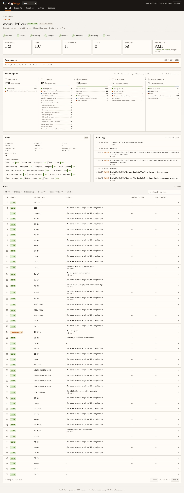
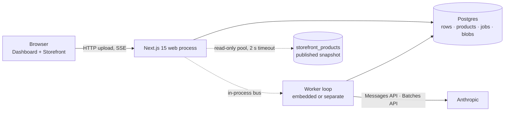
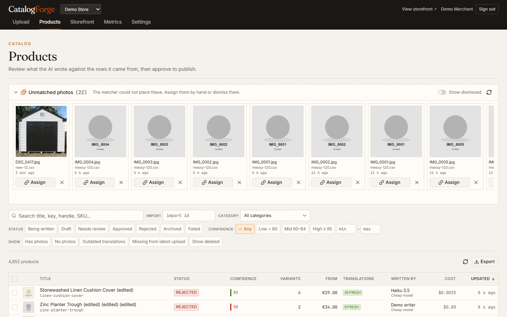
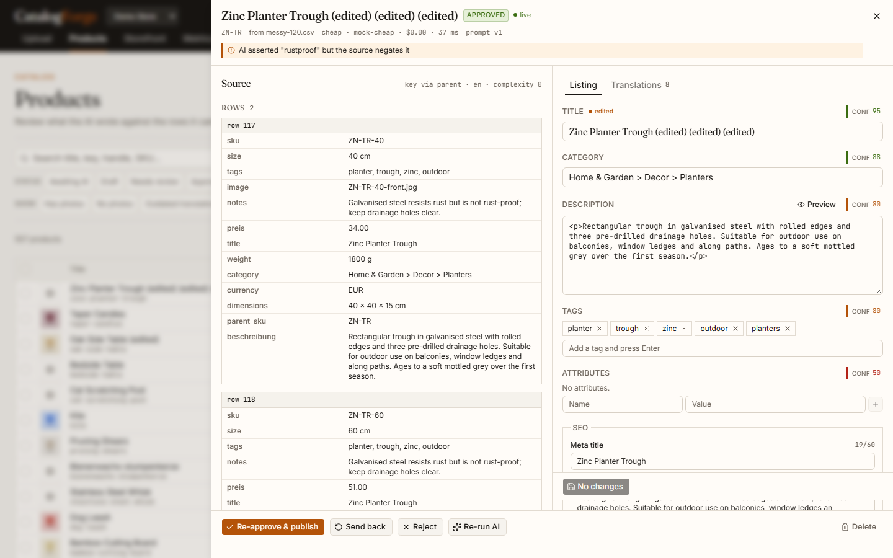
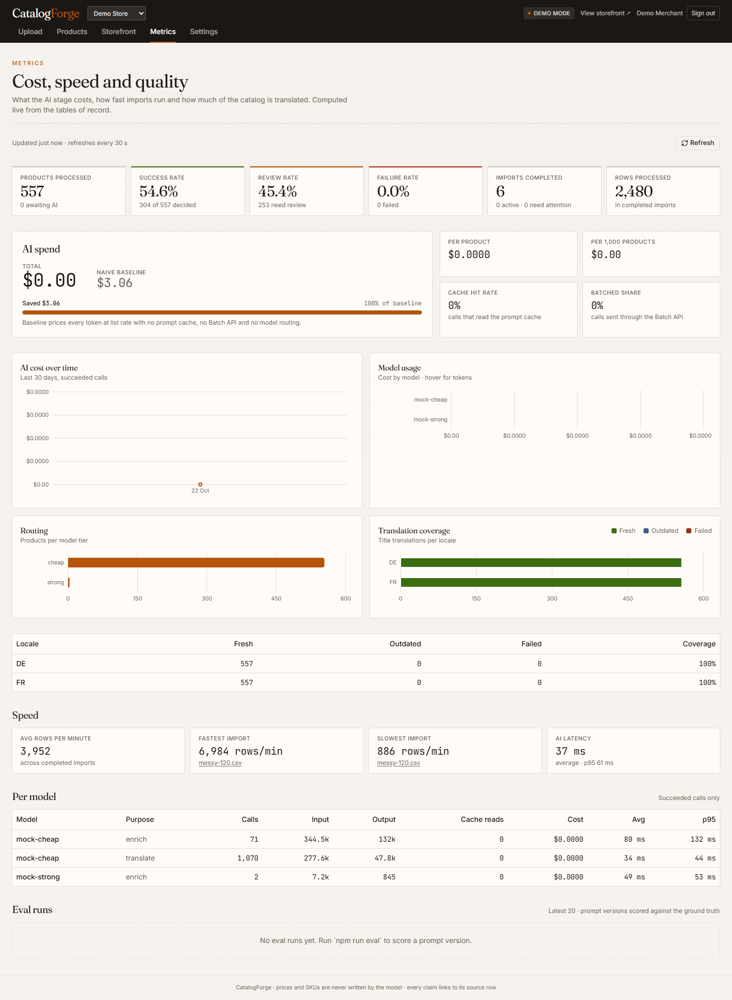
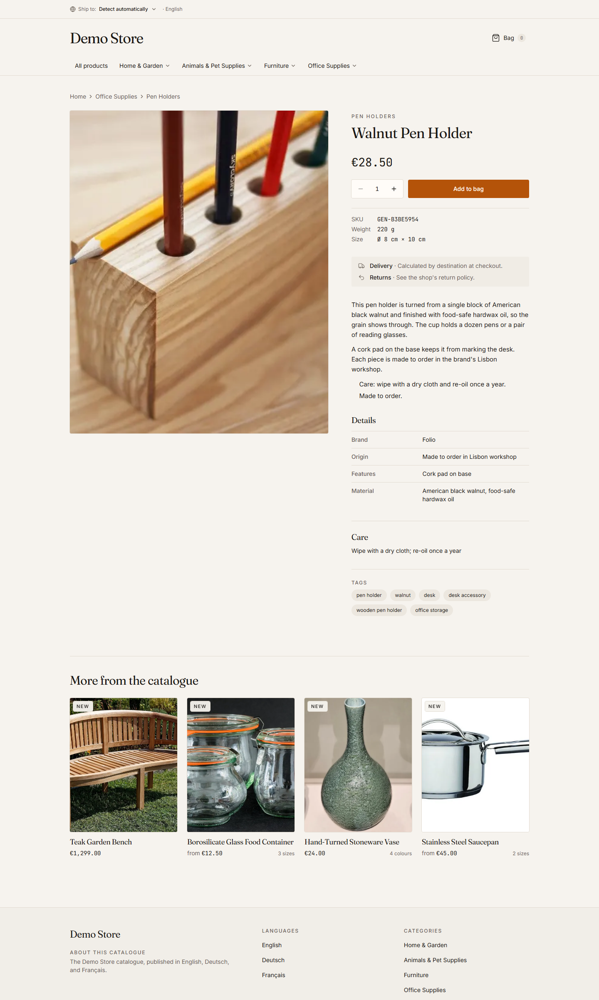

# CatalogForge

Drop in a messy supplier spreadsheet and a folder of photos; get a clean, reviewed, three-language product catalog with a live storefront. Built for the CatalogForge assignment by Ryanveer Singh.

- **Live demo:** _(URL added at deployment; see "Deploying" below)_ · sign in with `demo@catalogforge.dev` / `demo1234`
- **Sample files:** downloadable from the Upload tab (or `samples/`), from a 10-row happy path to a 10,000-row bulk sheet and a deliberately broken photo ZIP
- **Edge cases:** [EDGE-CASES.md](EDGE-CASES.md) (first commit, 139 entries, statuses kept current) · **Plan:** [docs/PLAN.md](docs/PLAN.md) · **Eval harness:** [eval/README.md](eval/README.md)



## What it does

```
upload ──► parse ──► clean ──► group ──► AI write ──► ground ──► translate ──► review ──► storefront ──► export
            sniff     prices    products  8 per call   claims     DE/FR ahead   approve    published      CSV/JSON/
            encoding  units     variants  cheap/strong  numbers    of time       edit       snapshot       Shopify
            headers   HTML      dupes     batch API     category   cached        re-run                    
```

Four rules shape every design decision:

1. **The model never touches money or identity.** Prices (integer cents + ISO currency), SKUs, weights, dimensions and variant options come from deterministic, unit-tested code. The model only writes words.
2. **Code checks the words.** A grounding validator verifies every claim against the supplier's cells, understands negation ("frost-resistant, not frost-proof"), audits every number, and snaps categories to a taxonomy. Anything it cannot find is removed and the product goes to review with a reason.
3. **Postgres is the only source of truth.** The job queue is a Postgres table; a killed process, a lost cache or a second upload of the same file cannot lose or duplicate work.
4. **Draft and published are separate.** The storefront reads a published snapshot through its own connection pool. Imports, re-runs and reviews can never slow it down or leak into it.

## Architecture



| Layer | Choice | Why |
|---|---|---|
| App | Next.js 15 (App Router), React 19, TypeScript strict, Tailwind v4, shadcn/ui, TanStack Table, Recharts | One deployable for dashboard, storefront and API; Node runtime for SSE and long requests |
| Data | PostgreSQL + Drizzle ORM; Neon (free) in production, Docker locally | Type-safe SQL, first-class upserts, additive migrations run at boot under an advisory lock |
| Queue | A `jobs` table: `INSERT … ON CONFLICT DO NOTHING` keys, `FOR UPDATE SKIP LOCKED` claims, leases + reaper, backoff with jitter, per-queue pause | Enqueueing the next stage is one transaction with the row update; nothing to lose when memory goes away; the worker sleeps when idle so the free database can autosuspend |
| AI | Anthropic SDK: Haiku 5.5 (cheap), Sonnet 5.5 (strong, vision), Opus 5.5 (manual escalation); structured outputs via Zod; prompt caching; Message Batches API | Three price points, strict JSON, half price for large imports |
| Files | papaparse, SheetJS, jschardet + iconv-lite, sanitize-html, yauzl, sharp | Streaming where it matters; magic-byte sniffing, never trust the extension |
| Storage | `pg` blob driver (free deployment), `local` for dev; an `s3` driver is the documented path beyond demo scale | The free tier has no bucket; photos are stored only as 800 px WebP + 400 px thumbnails |
| Hosting | Render free web service with the worker embedded + Neon free Postgres | Card-free; the same code runs as separate web + worker containers via `docker compose --profile full` |

Folder layout: `src/core` is pure TypeScript (no I/O) and holds parsing, cleaning, grouping, grounding, translation protection and export; `src/db` schema, migrations and store-scoped repositories; `src/queue` the Postgres queue; `src/jobs` the pipeline stages and the driver; `src/worker` the loop; `src/providers` AI and storage drivers; `src/app` routes and pages; `src/components` UI; `eval` the evaluation harness; `samples` sample data with ground truth; `scripts` generators, load test, smoke test.

## Setup

Prerequisites: Node 22, Docker Desktop (for local Postgres), an Anthropic API key (optional: without one the app runs in demo mode with a deterministic stand-in provider).

```bash
git clone https://github.com/RyanveerSingh/Assignment-Catalog-Forge.git catalogforge
cd catalogforge
npm ci
docker compose up -d postgres
cp .env.example .env.local        # set ANTHROPIC_API_KEY=sk-ant-… and AI_PROVIDER=anthropic, or leave mock
npm run db:migrate && npm run seed # demo@catalogforge.dev / demo1234, stores "demo" and "second"
npm run dev                        # web on http://localhost:3000
npm run dev:worker                 # the worker, in a second terminal
```

Useful commands:

| Command | What it does |
|---|---|
| `npm run check` | typecheck + lint + all tests (integration tests need `DATABASE_URL`) |
| `npm run samples` | regenerate `samples/` deterministically (seed 42) |
| `npx tsx scripts/run-import.ts --file samples/bulk-10000.csv` | run an import with an in-process worker and print rows/min and cost |
| `npx tsx scripts/smoke.ts --base http://localhost:3000` | end-to-end HTTP smoke test (upload → review → storefront → export) |
| `npx tsx scripts/load-test.ts --base … --store demo --handle <handle> --label idle` | autocannon against the storefront, writes `docs/load/*.json` |
| `npm run eval -- --sample messy-120 --provider mock` | score the pipeline against labelled ground truth |
| `docker compose --profile full up --build` | web + separate worker containers (kill the worker to watch an import resume) |

Per-store API keys can be set in Settings (encrypted at rest); a server key in `ANTHROPIC_API_KEY` is the fallback; with neither, demo mode is on and the masthead says so.

## The pipeline, stage by stage

| Stage | Unit | What happens | Idempotency |
|---|---|---|---|
| ingest | file | Sniff type by magic bytes; detect encoding, delimiter and header row; map columns through an EN/DE/FR synonym dictionary with content-based disambiguation; insert raw rows in 500-row chunks; extract ZIP photos | rows `ON CONFLICT DO NOTHING` on `(import, row_number)` |
| clean | 500 rows | Mojibake repair, placeholders, prices → integer cents with per-column locale inference, units → cm/grams, colour vocabulary, HTML allowlist, language detection, issues per row | only rows still at stage `parsed` |
| group | import | Product keys (parent SKU → SKU stem with matching base title → title → single row), variants, forward-fill of parent/child layouts, exact duplicates, SKU conflicts, option inference from titles, near-duplicate badges, complexity score, photo matching ladder | upsert by `(store, product_key)` and `(store, sku)`; unchanged source hash → AI skipped |
| enrich | ≤ 8 products | One structured-output call per tier (cheap / strong / vision); Economy mode submits one Message Batch per tier and polls | response persisted before use; content-addressed cache; stable batch keys |
| ground | product | Citation check, lexicon sweep, negation check, number audit with unit conversion, taxonomy snapping, product mix-up check, care-instruction restoration, confidence = min(model, heuristic) | pure function |
| translate | product | Fields hashed; manual fixes kept (marked Out of date if English moved on); store-wide cache by `(hash, locale)`; placeholders, tags, numbers and glossary protected by sentinels and verified | unique `(product, field, locale)` |
| finalize | import | Open rows closed as Failed with a reason; invariant `done + needs_review + failed = total`; cost summary and savings; products missing from this upload flagged | mismatch → `needs_attention`, never a fake "done" |

A DB-driven driver (`src/jobs/drive.ts`) looks at the tables after every job, on boot and every 30 seconds, and enqueues whatever is missing by deterministic key. Restart recovery, host spin-down, Redis-free operation and concurrent imports all reduce to "read the database, enqueue what is missing".

## Scale strategy: queue, retries, restarts, duplicates

- **Restart mid-import.** Jobs live in Postgres with a 60-second lease renewed by heartbeat. A killed worker's jobs are reclaimed by the reaper; each handler processes only rows/products not yet past its stage with compare-and-set updates, so a re-run cannot double-apply. The integration test kills the worker during an import and asserts every row lands exactly once.
- **AI failures.** Provider errors are classified (`rate_limit`, `overloaded`, `timeout`, `network`, `invalid_json`, `max_tokens`, `auth`, `billing`, `bad_request`, `refusal`) and mapped onto queue behaviour: 429 pauses the AI queue for `retry-after` and the import shows "Paused — resuming in X min" without burning an attempt; 5xx/timeouts back off exponentially with jitter up to five attempts; invalid output escalates to the strong model and then splits the batch; auth/billing problems pause the import with a banner until a key is fixed; refusals and 400s fail only the affected products with the reason.
- **Rate-limit and chaos demo.** Settings → Testing lets you inject 429s, timeouts and malformed JSON at a chosen rate, and "Crash worker now" exits the process so the host restarts it; the import resumes with the counts unchanged.
- **No duplicates.** A file's SHA-256 is unique among active imports per store (a second upload of the same file joins the running import). Products and variants upsert by stable keys; unchanged products on a re-upload skip the AI entirely and cost nothing; changed cells re-run it. Manual edits are stored as overrides that later runs never overwrite.
- **Counts always add up.** Row statuses roll up from product outcomes; duplicate rows close as `done · duplicate of N`; cancelled or orphaned rows close as `failed` with the reason. Finalize asserts the invariant.
- **Storefront stays fast.** It reads `storefront_products` only (one indexed row per product and locale, written on approve) through a separate pool with a 2-second statement timeout, cached for 30 seconds. It never joins import tables and never calls the AI. Load-test numbers below.
- **Fairness and budget.** Small imports get a higher queue priority; every import has a spend cap (default $5) that pauses it when reached.

## Cost optimisation

- **Routing.** A complexity score from the cleaning stage (issues, conflicts, language, missing text) sends clean rows to Haiku 5.5 and messy ones to Sonnet 5.5; the vision model runs only when photos exist and the text is too thin to name or categorise the product.
- **Batching.** Up to eight products per call, and in Economy mode one Message Batch per tier at half price with per-item fallback to realtime on errors, expiry or a two-hour timeout.
- **Three caches.** The provider-side prompt cache for the stable system prompt (taxonomy, rubric, few-shots); a content-addressed cache of model responses keyed by model + prompt version + input, so re-uploads and re-runs with unchanged content never pay twice; a global translation cache keyed by source hash, locale and model (so a demo-provider or superseded-model translation is never reused).
- **Tracking.** Every call records tokens (input, output, cache read/write), model, purpose, latency and cost in micro-dollars. The Metrics tab shows cost per import, per model, per product and per 1,000 products, plus a savings meter against the naive baseline (strong model, realtime, no cache).

## Accuracy and quality assurance

- Prices: 104 unit cases covering `1.299,00 €`, `£8`, `$ 1 299.99`, `12,50`, `EUR 12`, placeholders, negatives, zero, ranges and the ambiguous `1.299` (read as thousands and flagged, because no retail price has three decimals).
- Units: cm/mm/m/in/ft and g/kg/lb/oz with compound forms, labelled dimension strings, plausibility ranges.
- Grouping: deterministic keys, forward-fill, duplicates, conflicts, option inference. On the 1,000-row sample the grouper recovers 477 of 477 ground-truth products with no merges or splits.
- Grounding: claims must be cited and present in the source; polarity is compared both ways, so "not frost-proof" against a source that says the same is faithful while asserting what the source denies (or denying what it asserts) is removed even when cited; negation is scoped to the clause, so a "will not" in the previous sentence cannot poison the next claim; numbers are audited with unit conversion; categories are snapped to the taxonomy; a title that does not match its rows is flagged as a possible mix-up; dropped care instructions are restored from the source.
- Evaluation harness: `samples/ground-truth/*.json` holds per-product truth (SKUs, cents, currency, title keywords, category prefix, allowed and negated claims, expected status). `npm run eval` reports product/variant recall and precision, price exactness, title and category accuracy, claim precision/recall, negated-claim violations (a hard rule: the run fails if it is not zero), review precision/recall and duplicate detection, and writes a JSON report for A/B comparison of prompt versions and models.

## Measured numbers

Local machine, Docker Postgres. The first block uses the demo provider (deterministic stand-in, zero cost); the second block is the real models (Haiku 5.5 cheap tier, Sonnet 5.5 for photos and escalation) on the same scripts.

| Measurement | Value |
|---|---|
| 1,000-row sample, Fast mode, AI concurrency 4 | 33 s end to end, ≈ 1,800 rows/min, 477 products, counts 1000/1000 |
| 120-row messy sample with 56-file photo ZIP over HTTP (upload → finished) | 8 s first time; 2 s when re-uploaded unchanged (no AI calls) |
| 10,000-row sample, Fast mode, two workers (one embedded in the web process, one standalone), AI concurrency 4 each | 7.2 min end to end (434 s) ≈ 1,380 rows/min including translation of 4,758 products into DE and FR; parse → clean → group → AI finished at 194 s (≈ 3,100 rows/min); 10,000/10,000 rows terminal (4,746 done, 5,254 need review, 0 failed) |
| Storefront during the 10k import (autocannon, 50 connections, 30 s, two workers busy on the same laptop) | collection page 145 req/s, p50 341 ms, p99 448 ms; product page 154 req/s, p50 320 ms, p99 410 ms; 0 errors, 0 non-2xx |
| Storefront idle (same settings) | collection 100 req/s, p50 469 ms, p99 694 ms; product 107 req/s, p50 465 ms, p99 540 ms; 0 errors. Throughput is the same with or without an import running: the ceiling is one Node render process on a laptop, not the database |
| Storefront idle, 10 connections | collection 116 req/s, p50 85 ms, p99 128 ms; product 116 req/s, p50 85 ms, p99 120 ms |
| Eval, messy-120, demo provider | product recall 98.3%, variant recall 99.1%, price exactness 99.1%, title keywords 93.0%, category 75.4%, negated violations 0, duplicate precision/recall 100% |
| **Real models.** Eval, messy-120 (58 products, 57 routed to Haiku, 1 to Sonnet) | product recall 98.3%, variant recall 99.1%, price exactness 99.1%, title keywords 100%, category 100%, negated violations 0, review recall 100%, review precision 57%, status accuracy 94.7%; 9 calls, 0 failed, mean 20 s per 8-product call, 184 s, $0.043 (56k cached input tokens, 54k output tokens) |
| Real models. 120-row messy sample with the 56-file photo ZIP, Fast mode, AI concurrency 4 | 212 s end to end (AI stage done at 68 s, the rest is translation into DE and FR); 58 products incl. 27 with photos sent to Sonnet vision; 100 done, 20 need review, 0 failed; $0.049 |
| Real models. 1,000-row sample, Fast mode, AI concurrency 6 | 973 s end to end (16 min) ≈ 62 rows/min; parse → clean → group → AI done at 233 s (≈ 257 rows/min), the remaining 12 min is 954 translation calls into DE and FR; 477 products (446 done, 31 need review), 1,000/1,000 rows terminal (917 done, 83 need review, 0 failed); 62 listing calls (60 Haiku, 2 Sonnet escalations after a bad answer), 0 rate-limit pauses; 3 of 7,924 translated fields failed verification and fell back to English with a flag |
| Measured cost per 1,000 products, real models, routed, realtime (no Batch API) | $1.93 all in from the request log: $0.51 for the English listing (Haiku, cached system prompt, ~900 output tokens per product) and $1.42 for translation into two locales. Economy mode (Batch API) halves both; the earlier estimate of ≈ $21 for Sonnet-everywhere realtime stands |

## Dashboard






- **Upload:** drag-and-drop sheet + photos/ZIP, Fast vs Economy, budget, live SSE progress with a stage stepper, KPIs, sheet mapping, event log and a filterable per-row table with issues and reasons.
- **Products:** server-side paginated table (10/25/50/100), sorting, search, status and confidence filters, colour-coded confidence with the number always shown, bulk approve with an explicit opt-in for products that need review, CSV / JSON / Shopify CSV export.
- **Review drawer:** source rows and photos beside the editable listing; claim chips highlight the cell they came from; optimistic-version saves; translations per locale with manual fixes and Out-of-date flags; approve, send back, reject, re-run with a different model or prompt version, delete/restore.
- **Storefront:** collection and product pages in the visitor's language (country switcher; DE/AT → German, FR → French, else English), per-field English fallback with a notice, mobile-first.
- **Metrics:** processed counts and rates, cost over time, model usage, routing, savings meter, translation coverage and Out-of-date counts, speed (fastest and slowest import, AI latency), eval runs.
- **Settings:** store, languages and country map, glossary, API key, budget, chaos panel, crash button.

## Public API

Create a key in Settings, then:

```bash
curl -X POST https://<host>/api/v1/imports -H "Authorization: Bearer cf_live_…" -F sheet=@samples/messy-120.csv -F photos=@samples/photos-messy.zip -F mode=fast
curl https://<host>/api/v1/imports/<id> -H "Authorization: Bearer cf_live_…"
curl https://<host>/api/v1/products?status=approved -H "Authorization: Bearer cf_live_…"
```

## Deploying (free tier)

1. **Neon:** create a free project, copy the direct connection string.
2. **Render:** New → Blueprint → this repository (`render.yaml` defines one free web service with the worker embedded). Set `DATABASE_URL`, `ANTHROPIC_API_KEY` (optional), `APP_BASE_URL` (the Render URL). `APP_SECRET` is generated; `SEED_DEMO=true` creates the demo accounts at boot.
3. Migrations run at boot under an advisory lock. The free instance spins down after 15 minutes without traffic and wakes in about a minute; a watched import keeps it awake, and an unwatched one resumes on the next request exactly like a restart.

## Not built, and why

Nothing in the required feature list is missing. Six items from the "beyond" list were cut, in the order the plan set out, to protect the four non-negotiables (resume after restart, never duplicate, never invent, storefront stays fast). Each is listed with its reason and its fix in `EDGE-CASES.md` → "Not built (and why)": webhooks on import completion (tables and hook point exist, delivery job not written), image URL download (needs an SSRF allow-list before it is safe to ship), manual photo assignment (automatic matching covers 48 of 53 photos in the messy sample), an output-language guard (no non-English output observed in any run), locale back-fill and translation chunking (a too-long field falls back to English with a visible flag), an orphan-blob sweep and per-key API rate limiting.

## Technical write-up

**Hardest part.** Making "resume after a restart" and "never duplicate" true by construction rather than by luck. The answer was to stop treating the queue as the orchestrator: Postgres holds every row's stage and status, jobs are idempotent slices with deterministic keys, and a driver re-derives the missing work from the tables. Once that held, host spin-down, Redis-free operation, re-uploads and concurrent imports stopped being special cases.

**Accuracy and invented claims.** Two layers. First, the model is structurally unable to write prices, SKUs, weights or dimensions: the output schema has no such fields and the deterministic cleaner owns them. Second, the grounding validator does not trust the words: every claim must cite a row and column and the quote must exist; a lexicon sweep catches marketing terms the model slipped into the text without citing; negation within three tokens of the same clause ("not frost-proof") removes an asserted claim even when cited, and the check runs both ways, so a listing that denies what the source asserts is caught too while a faithful "not frost-proof" passes; numbers must exist in the source after unit conversion; categories must be taxonomy paths. The demo provider deliberately asserts negated claims so the validator's effect is visible in every demo import. The first run against the real models exposed the validator's own bias: it only knew how to catch a model that asserts too much, and Claude mostly writes careful negations ("not certified organic", "indoor only, not frost-proof"), which the one-way check flagged as violations and sent 88% of products to review. Comparing polarity on both sides and stopping the negation window at sentence boundaries fixed it without weakening the hard rule (negated violations stayed at zero in every eval run).

**Measured numbers.** See the table above; the 10k run and the load test are reproducible with the scripts listed in Setup.

**What breaks first at 1,000,000 products in 8 languages.** Translation volume (8M field sets) dominates cost and queue time: batch everything, translate on publish only, give translation its own worker pool and rate budget. The Postgres-backed queue becomes a hotspot around a few thousand jobs per second: move dispatch to Redis Streams or SQS and keep Postgres as the state of record (the swap is contained in `src/queue` because the driver already tolerates queue loss). `storefront_products` at 8M rows is fine with its indexes, but tag invalidation becomes the hot path: put the snapshot behind a CDN-backed KV keyed by `(store, locale, handle)`. Blobs must leave Postgres for object storage with a CDN. Partition `import_rows` by import and archive raw rows after 30 days. Add per-store concurrency quotas so one bulk merchant cannot starve interactive ones.

**What I learned.** The messy-data problems are mostly deterministic and testable; the model is the easy part to add and the hard part to trust. Writing EDGE-CASES.md first changed the design: the draft/published split, the count invariant and response-first persistence all came from entries written before any code. A deterministic stand-in provider gets the plumbing right but not the judgement calls: every validator rule that looked finished against the mock had to be re-checked against real output (the one-way negation check above, Haiku writing ~900 output tokens per product and overrunning a 12k limit for eight products, translation turning out to be the throughput bottleneck at one seven-second call per product and locale). And the framework has its own edge cases: Next.js revalidates a stale cache entry once per request, so fifty concurrent shoppers fired fifty identical queries at a four-connection pool until the loaders were single-flighted.

**How AI was used while building.** Claude Code did the implementation under a written plan and conventions file; independent pure modules (price and unit parsing, text and HTML cleaning, parsing, grouping, export, the UI tabs, the eval harness, the sample generator) were built in parallel by sub-agents against explicit contracts and reviewed, tested and integrated by hand. Every claim about behaviour in this README is backed by a test or a script in the repository.
